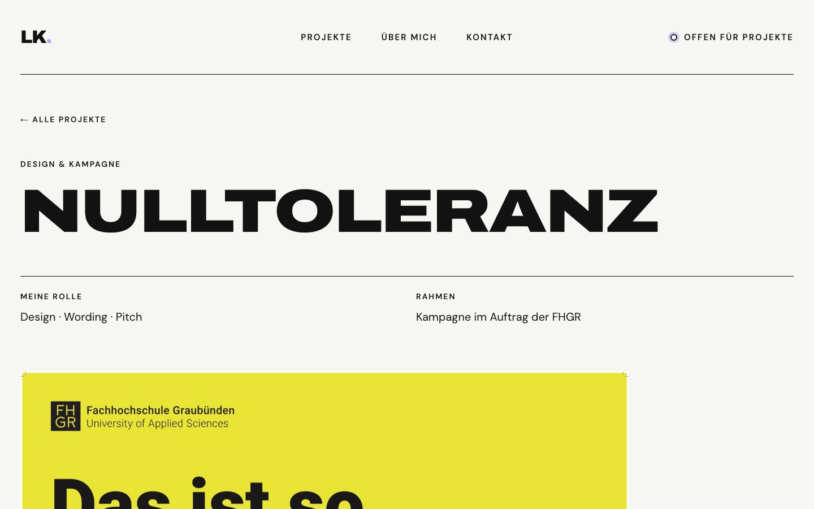
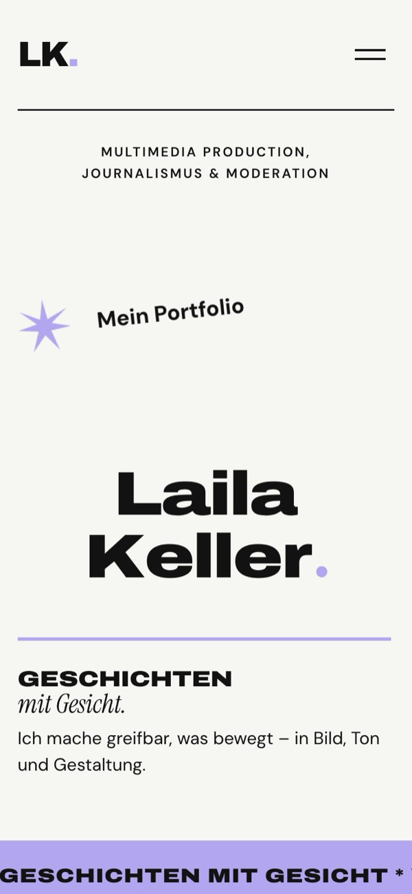
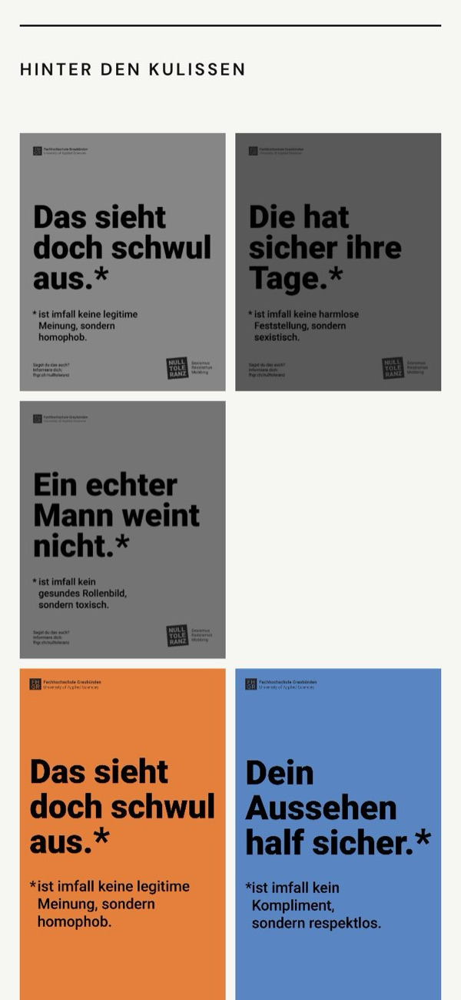

# Portfolio Laila Keller – Geschichten mit Gesicht

Persönliche Portfolio-Webseite mit eigenem CMS, umgesetzt im Modul Interaktive Medien 5 (HS26, FHGR).

**Live:** https://lailakeller.ch

## Projektbeschreibung

Dieses Portfolio zeigt meine Arbeit als Multimedia Producerin, Journalistin und Moderatorin unter dem Leitgedanken «Geschichten mit Gesicht». Die Startseite führt mit einem animierten Einstieg, einem Karussell ausgewählter Projekte, einem Teil «Über mich» mit Skills und einem Kontaktbereich durch meine Arbeit. Jedes Projekt hat eine eigene Detailseite mit Video oder Bild, Beschreibung und einer Galerie mit Bildern und Videos hinter den Kulissen, die sich vergrössert ansehen lassen. Alle Inhalte liegen in einer MySQL-Datenbank und werden über eine eigene PHP-Schnittstelle als JSON per fetch geladen. Gepflegt werden sie in einem selbst gebauten CMS mit Login: Projekte anlegen, bearbeiten, sortieren und verstecken, Bilder und Videos hochladen, Skills und Status ändern. Umgesetzt ohne Framework in HTML, CSS, JavaScript und PHP, nach einem eigenen Entwurf.

## Screenshots

| Startseite | Detailseite |
|---|---|
|  |  |

| Handy: Startseite | Handy: Galerie mit Bildern und Videos |
|---|---|
|  |  |

## Technologien

- **Frontend:** HTML, CSS, JavaScript (ohne Framework)
- **Backend:** PHP 8 mit PDO, MySQL/MariaDB
- **Schnittstelle:** eigene JSON-API (`api/`), abgefragt per `fetch`
- **Hosting:** Hostpoint

## Ordnerstruktur

```
portfolio/
├── index.html, projekt.html   Startseite (One-Pager) und Detailseite (projekt.html?id=3)
├── css/                       style.css (Webseite), admin.css (CMS)
├── js/                        main.js (alle Seiten), startseite.js, projekt.js
├── api/                       Schnittstellen: projekte.php, skills.php, einstellungen.php
├── admin/                     CMS: Login, Projekte, Bilder und Videos, Über mich & Status
├── includes/                  Datenbank-Verbindung, Login/Session, Bild-Upload (für Browser gesperrt)
├── images/                    feste Bilder der Webseite
├── uploads/                   Bilder und Videos aus dem CMS (nicht im Repository)
├── datenbank/                 SQL-Dateien: Tabellen, Startinhalte, Update
├── docs/                      Arbeitsjournal und Screenshots
└── config.example.php         Vorlage für die Zugangsdaten (echte config.php nicht im Repository)
```

## Setup

### Lokal (MAMP)

1. Repository klonen, in MAMP das Stammverzeichnis auf den Projektordner setzen
2. In phpMyAdmin eine Datenbank `efanahiw_portfolio` (Kollation `utf8mb4_unicode_ci`) anlegen und nacheinander `datenbank/portfolio.sql` und `datenbank/update_01_video_und_bilder.sql` importieren
3. `config.example.php` zu `config.php` kopieren und die Zugangsdaten eintragen
4. `http://localhost:8888/admin/einrichten.php` aufrufen und den CMS-Zugang anlegen (funktioniert nur einmal)
5. Webseite unter `http://localhost:8888`, CMS unter `/admin`

### Online (Hostpoint)

1. Lokale Datenbank exportieren (Tabelle `benutzer` ohne Inhalt) und in phpMyAdmin von Hostpoint importieren
2. `config.php` mit den Online-Zugangsdaten anlegen
3. Alle Dateien ausser `.git`, `README.md`, `docs/` und `datenbank/` per FTP über TLS hochladen, inklusive der versteckten `.htaccess`-Dateien und des Ordners `uploads/`
4. PHP 8.1 oder neuer (getestet mit 8.3 und 8.5)
5. Über `/admin/einrichten.php` einen eigenen Zugang mit neuem Passwort anlegen

## Umsetzungsprozess

Das ausführliche Protokoll mit allen Entscheidungen steht im **[Arbeitsjournal](docs/arbeitsjournal.md)**, Vorher-nachher-Bilder der Zwischenstände unter **[Entwicklung in Bildern](docs/arbeitsjournal.md#entwicklung-in-bildern)**. Zusammengefasst:

1. **Planung und Einrichtung:** Entwurf in Figma Make. Bewusster Entscheid, den erzeugten React-Code nicht zu übernehmen, sondern alles selbst in HTML, CSS und JavaScript aufzubauen, damit der Code schlank und nachvollziehbar bleibt. Einrichtung von MAMP, GitHub und Hostpoint.
2. **Statisches Frontend:** One-Pager nach Entwurf. Der Hero zeigt statt eines grossen Porträts reine Typografie mit Animation: Die Buchstaben gleiten ins Bild, ein lila Punkt wird zum Kreis, der der Maus folgt.
3. **Datenbank und Schnittstelle:** Tabellen für Projekte, Bilder, Skills, Einstellungen und Benutzer, darunter eine 1:n-Beziehung zwischen Projekten und Bildern. Eine eigene JSON-Schnittstelle liefert die Inhalte, das Frontend lädt sie per `fetch` und baut daraus Karten und Detailseiten.
4. **CMS:** Login mit Passwort-Hash und Session, Projekte anlegen, bearbeiten, sortieren und verstecken, Upload von Bildern (automatisch gedreht und verkleinert) und Videos, Bearbeitung von Skills und Status.
5. **Gestaltung und Inhalte:** Galerie mit eigenen Reihen für Hoch- und Querformate, Lightbox, Videos mit Autoplay beim Scrollen. Claim «Geschichten mit Gesicht», Texte durchgehend auf Deutsch, kursive Akzentschrift für Ruhe in den grossen Überschriften.
6. **Online stellen:** Datenbank-Export, Test mit PHP 8.5, Upload per FTP über TLS, Sicherheitsprüfung von aussen.

Über das ganze Projekt wurde jeder Schritt lokal getestet, am Desktop und auf dem Handy, und die Sicherheit (SQL-Injection, XSS, CSRF, Uploads) gezielt geprüft.

## Learnings und Schwierigkeiten

**Learnings**

- **Sicherheit von Anfang an:** Prepared Statements gegen SQL-Injection, Ausgabe mit `htmlspecialchars` bzw. `textContent` gegen XSS, CSRF-Token in jedem Formular, Passwörter nur als Hash. Einem Upload nie trauen: Ob eine Datei wirklich ein Bild ist, zeigt erst ein Blick in ihren Inhalt.
- **Client und Server:** HTML, CSS und JavaScript laufen im Browser, PHP und `fetch` brauchen einen Server. Lokal und online sind zwei getrennte Datenbanken mit eigenen Zugangsdaten.
- **Browser-Cache:** Änderungen an CSS und JavaScript erscheinen nicht immer sofort. Gelöst mit `Cache-Control: no-cache` und Versionsnummern an den CSS-Adressen im CMS.
- **Bilder fürs Web:** verkleinern, richtig drehen (EXIF-Orientierung von Handyfotos) und ihr echtes Format zeigen statt sie zu beschneiden.
- **Gestaltung braucht Entscheidungen:** Eine Galerie kann Bilder entweder gleich gross machen oder Reihen bündig füllen, beides geht nicht. Ein klarer Claim hilft, alle Texte einer Seite aufeinander abzustimmen.

**Schwierigkeiten**

- **iCloud und Git:** Bei vollem Speicher hat iCloud die Projektdateien ausgelagert, Git konnte nicht mehr arbeiten. Lösung: Projekt in einen Ordner ohne Cloud-Sync verschoben und frisch von GitHub geklont.
- **Mobile Darstellung:** Lange deutsche Wörter («Medienmacher:innen», «Anspruch.») waren breiter als ein Handy-Bildschirm. Gelöst mit erlaubten Umbruchstellen, Silbentrennung und Schriftgrössen in `vw`.
- **Unterschiedliche Formate in der Galerie:** Hoch- und Querformate gemischt wirkten unruhig oder unterschiedlich gross. Nach mehreren Versuchen: eigene Reihen für Hoch- und Querformate mit fester Höhe.
- **Neue PHP-Version auf dem Server:** Online läuft PHP 8.5, lokal 8.3. Eine dort veraltete Funktion (`imagedestroy`) hätte den Bild-Upload stören können und wurde vor dem Hochladen entfernt.

Alle Learnings im Detail stehen am Ende des [Arbeitsjournals](docs/arbeitsjournal.md#alle-learnings).

## Ressourcen und Hilfsmittel

- **Schriften:** Archivo, DM Sans und Instrument Serif (Google Fonts)
- **Entwurf:** Figma Make
- **Werkzeuge:** VS Code, MAMP, phpMyAdmin, GitHub, Cyberduck
- **Dokumentation:** Hostpoint Support Center (FTP, Domains, SSL)
- **KI-Unterstützung:** Claude (Anthropic) über Claude Code: Vorschläge für Code und Texte, Erklärungen zu jedem Schritt, Tests. Konzept, Gestaltungsentscheide, Inhalte und Texte stammen von mir. Jeder Schritt wurde von mir nachvollzogen, getestet und selbst committet.
