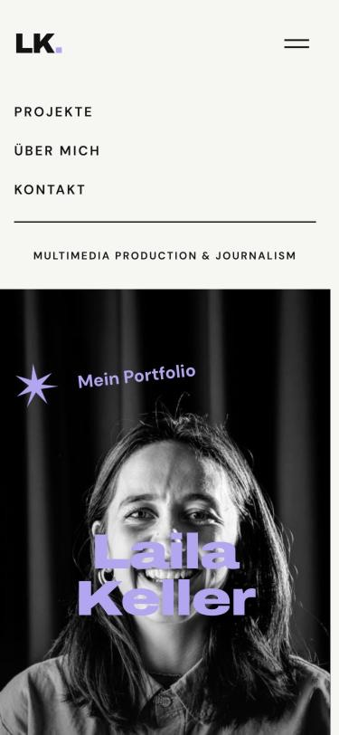
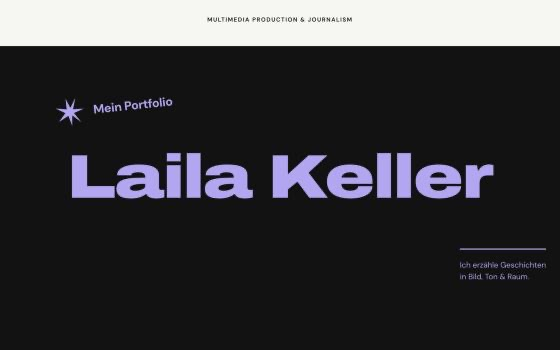
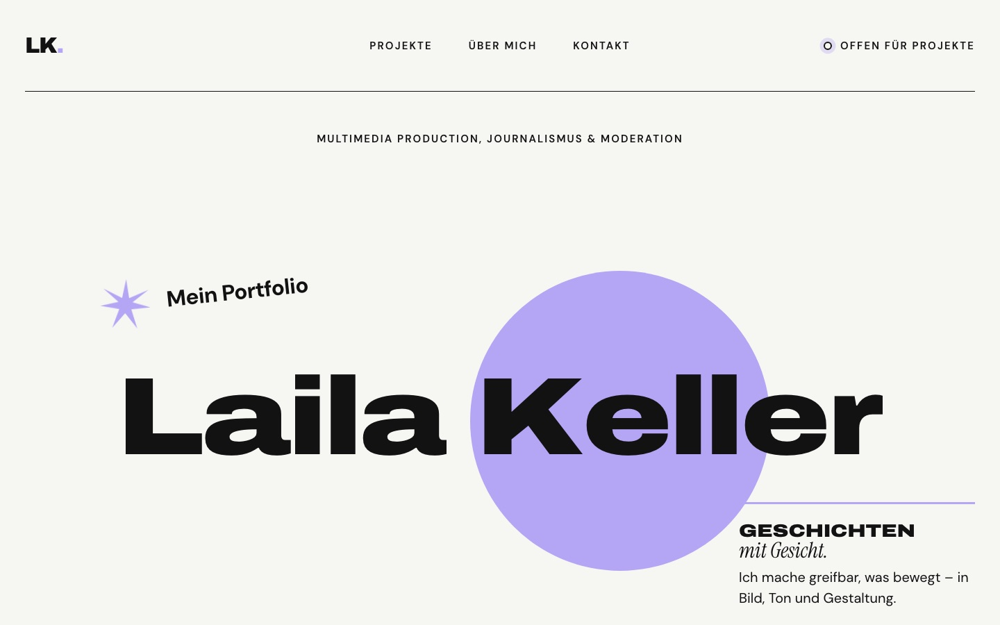
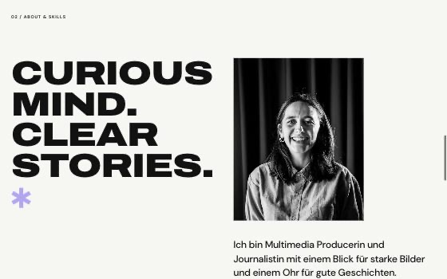
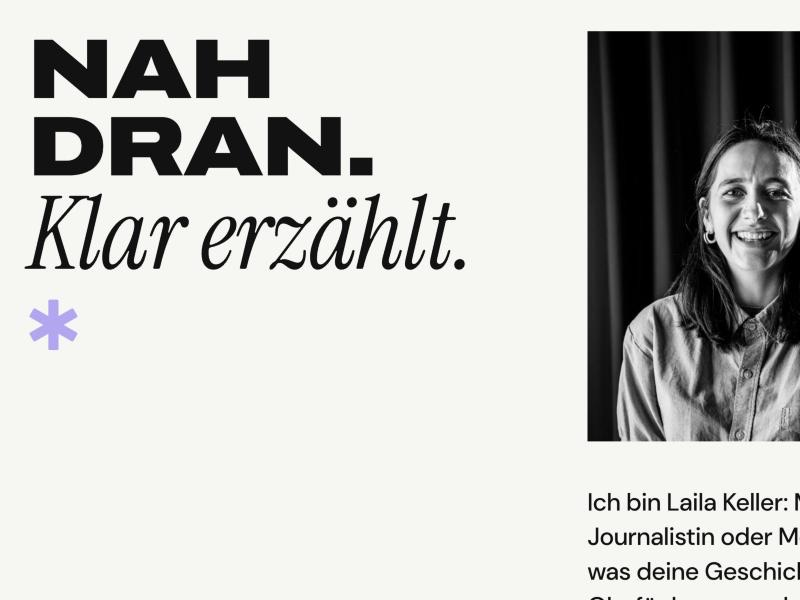
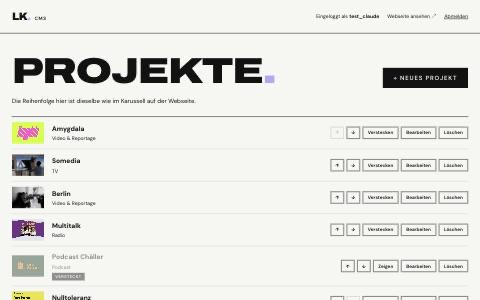
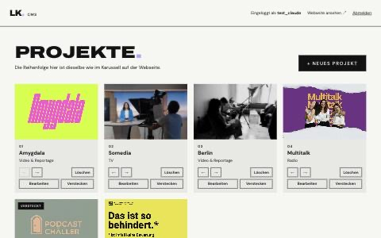
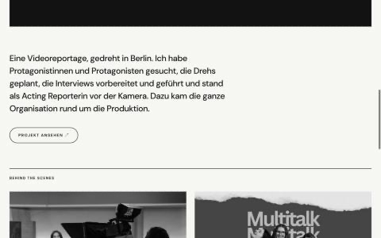
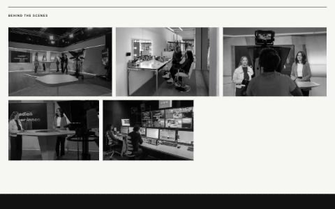
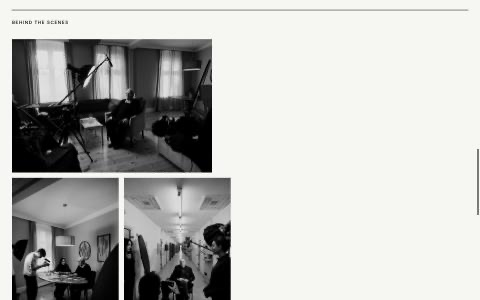

# Arbeitsjournal – Portfolio Laila Keller

Ausführliches Protokoll der Umsetzung: was wann gemacht wurde, welche Entscheidungen dahinterstehen und welche Probleme gelöst wurden. Die Zusammenfassung steht in der [README](../README.md). Bilder der Zwischenstände: [Entwicklung in Bildern](#entwicklung-in-bildern).

### 19.10.2026 – Kick-off und Planung
- Proposal eingereicht
- Grobes Design in Figma Make erstellt: One-Pager mit Hero, Projekt-Karussell, About & Skills und Kontakt
- Entscheid: Den von Figma Make erzeugten React-Code nicht übernehmen, sondern das Design von Grund auf in HTML, CSS und JavaScript nachbauen. So ist der Code schlanker und vollständig nachvollziehbar.
- Architektur festgelegt: statisches Frontend plus eigenes CMS mit PHP und MySQL. Das Frontend lädt die Inhalte später über eine kleine JSON-Schnittstelle (`api/`).

### 20.10.2026 – Hosting, Entwicklungsumgebung und Grundstruktur
- **Hosting:** Bestehendes Hostpoint-Webhosting der FHGR geprüft (gültig bis 2029). Mangels eigener Domain wird vorerst die Testdomain `efanahiw.myhostpoint.ch` verwendet.
- **Datenbank:** Neue Datenbank `efanahiw_portfolio` mit eigenem Benutzer angelegt. Die Datenbank des Vorsemesters bleibt unberührt.
- **Lokale Entwicklung:** MAMP eingerichtet, damit PHP und MySQL auf dem eigenen Mac laufen. Änderungen werden zuerst lokal unter `localhost:8888` getestet und erst danach hochgeladen.
- **Versionierung:** Öffentliches GitHub-Repository erstellt und in VS Code geklont.
- **Sicherheit:** Zugangsdaten gehören in eine `config.php`, die über `.gitignore` vom Repository ausgeschlossen ist. Im Repo liegt nur die Vorlage `config.example.php`.
- **Startseite:** Header, Hero, Projekt-Karussell, About & Skills und Kontakt nach dem Figma-Entwurf umgesetzt. Farben und Schriften sind als CSS-Variablen zentral definiert. Für Mobile gibt es ein Hamburger-Menü und angepasste Layouts.
- **Interaktionen (JavaScript):** Menü auf- und zuklappen; Projektkarten per Pfeil-Buttons durchblättern.
- **Hero-Bild:** Die Sektion war zunächst immer so hoch wie das Browserfenster, wodurch das Foto stark vergrössert und beschnitten wurde. Gelöst mit `aspect-ratio: 3 / 2`, also dem Seitenverhältnis des Fotos. Auf dem Handy wird die Sektion höher und das Bild auf das Gesicht ausgerichtet. Ein dunkler Verlauf am unteren Rand sorgt für lesbaren Text.
- **Kontaktlinks:** Der LinkedIn-Link funktionierte nicht, weil `https://` fehlte. Ohne Protokoll interpretiert der Browser die Adresse als Datei im eigenen Projekt.
- **Projektordner verschoben:** Der Ordner lag auf dem iCloud-synchronisierten Schreibtisch. Bei vollem Speicher hat iCloud die Dateien ausgelagert, sodass weder VS Code noch Git sie lesen konnten. Das Projekt wurde deshalb frisch von GitHub nach `~/Developer/portfolio` geklont, einen Ordner ohne iCloud-Sync. Das MAMP-Stammverzeichnis zeigt jetzt dorthin.
- **Header:** Logo von „MP“ auf meine Initialen „LK“ geändert. Die Navigation stand nicht genau in der Mitte, weil `justify-content: space-between` den Platz nur *zwischen* die Elemente verteilt und Logo und Status unterschiedlich breit sind. Gelöst mit einem CSS-Grid mit drei Spalten (`1fr auto 1fr`): Die äusseren Spalten sind immer gleich breit, die Navigation steht dadurch exakt mittig. Auf dem Handy bleibt der Header bei Flexbox (Logo links, Hamburger rechts).
- **Hero ohne Foto:** Ein bildschirmfüllendes Porträt direkt beim Einstieg wirkte zu dominant, und das Foto ist mit 1280 px Breite für grosse Bildschirme zu klein. Der Hero zeigt jetzt nur Typografie (Name, Stern, Claim) auf dunklem Grund. Das Porträt ist kleiner im Teil „Über mich“ eingebunden, dort reicht die Auflösung gut aus.
- **Porträt bei „Über mich“:** Im Hochformat 4:5 zugeschnitten mit `object-fit: cover`, schwarz-weiss per `filter: grayscale(1)`, beim Darüberfahren farbig. Die Datei heisst jetzt `portrait.jpg` (Kleinbuchstaben, passender Name statt `hero.JPG`). Das Sternchen sitzt neu unter der Headline, weil es rechts daneben ins Foto geragt hätte.
- **Echte Projekte im Karussell:** Die vier Platzhalterkarten mit Grafiken wurden durch sechs echte Projekte ersetzt: Amygdala, Somedia, Berlin, Multitalk, Podcast Chäller und Nulltoleranz. Jede Karte zeigt Kategorie, meine Rolle, den Rahmen (Modul bzw. Auftraggeberin) und ein Vorschaubild. Die Bilder sind schwarz-weiss und werden beim Darüberfahren farbig.
- **Vorschaubilder fürs Web aufbereitet:** Die Originale hatten verschiedene Formate (PNG, JPG, PDF) und bis zu 3000 px Breite. Mit dem Mac-Werkzeug `sips` wurden sie auf 1600 px Breite verkleinert und als JPG gespeichert (`images/projekte/`). Das PDF der Nulltoleranz-Kampagne wurde dabei in ein JPG umgewandelt, weil ein ``-Element keine PDFs anzeigen kann. Zusammen sind die Bilder jetzt rund 1 MB statt 4 MB gross. Im Browser haben alle Karten dasselbe Format 3:2 (`aspect-ratio` und `object-fit: cover`).
- **3D entfernt:** Die Karte „3D & Motion“ und der Skill Blender wurden gestrichen, weil es dazu keine Projekte gibt.
- **Fehler auf dem Handy:** Die Karte „Nulltoleranz“ war breiter als die anderen, weil das lange Wort nicht umbrechen konnte und die Karte deshalb mitwuchs. Gelöst mit `min-width: 0` auf der Karte und `hyphens: auto` beim Titel (Silbentrennung).
- **Heller Hero:** Ohne Foto war der Hero eine grosse schwarze Fläche, die nahtlos in den ebenfalls dunklen Teil „Selected Work“ überging. Der Hero ist jetzt hell mit dunkler Schrift, so wechseln sich helle und dunkle Bereiche auf der ganzen Seite ab.
- **Animation des Namens:** Beim Laden gleiten die Buchstaben von „Laila Keller“ nacheinander von unten ins Bild, danach erscheinen Stern und Claim. JavaScript verpackt dafür jeden Buchstaben in ein eigenes `` und gibt ihm eine Nummer (`--i`). Die CSS-Animation startet jeden Buchstaben um diese Nummer × 60 ms verzögert. Jedes Wort wirkt wie ein Fenster (`overflow: hidden`), deshalb sind die Buchstaben vorher unsichtbar. Für Screenreader bleibt der Name über `aria-label` normal lesbar. Wer im Betriebssystem „Bewegung reduzieren“ eingestellt hat, sieht den Namen sofort ohne Animation (`prefers-reduced-motion`).
- **Mehr Lavendel im Hero:** Der helle Hero wirkte zu leer. Drei Varianten skizziert (dezent mit Laufband, grosser Kreis, ganz lila Hintergrund) und zwei davon kombiniert:
  - Ein **lila Punkt** hinter dem Namen nimmt das Logo „LK.“ auf. Er ploppt nach den Buchstaben auf, löst sich dann, schwebt ein Stück weg und wächst zum **grossen lila Kreis** hinter dem Namen. Technisch sind Punkt und Kreis zwei Elemente: Sobald der Punkt fertig aufgeploppt ist (`animationend`), misst JavaScript mit `getBoundingClientRect()`, wo beide liegen und wie gross sie sind. Dann wird der Punkt ausgeblendet und der Kreis klein genau an seine Stelle gesetzt und mit der Web Animations API (`element.animate()`) an seinen Platz bewegt. Für das Auge ist es derselbe Punkt.
  - Danach **folgt der Kreis der Maus** über den ganzen Hero. JavaScript rechnet aus, wie weit die Maus von der Mitte des Kreises an seinem Ausgangsplatz entfernt ist (`offsetLeft`/`offsetTop`), und verschiebt ihn um genau diesen Abstand. Die Werte gehen als CSS-Variablen (`--mx`, `--my`) an die CSS, wo ein `transition` den Kreis weich hinterhergleiten lässt. Auf dem Handy (keine Maus) und bei „Bewegung reduzieren“ bleibt der Kreis still.
  - Ein **Laufband** zwischen Hero und Projekten zeigt meine Formate (Video, TV, Radio …) und trennt den hellen Hero vom dunklen Projektteil. Der Text steht zweimal hintereinander. Die Animation verschiebt ihn um genau die Hälfte, dann beginnt sie unbemerkt von vorn, so wirkt das Band endlos.

### 20.10.2026 – Datenbank
- **Tabellen geplant und angelegt** (`datenbank/portfolio.sql`):
  - `projekte`: alles, was eine Projektkarte und die Detailseite brauchen (Titel, Kategorie, Rolle, Rahmen, Beschreibung, Bild, optionaler Link). Dazu `reihenfolge`, um die Projekte im CMS sortieren zu können, und `sichtbar`, um ein Projekt zu verstecken, ohne es zu löschen.
  - `skills`: die Liste bei „Über mich“.
  - `einstellungen`: einzelne Werte nach dem Muster „Name → Wert“, z. B. der Status „Available for projects“. Neue Einstellungen brauchen so keine neue Spalte.
  - `benutzer`: Login fürs CMS. Gespeichert wird nur ein Hash des Passworts, nie das Passwort selbst.
- **Entscheid Kategorie:** Die Kategorie ist vorerst ein einfaches Textfeld statt einer eigenen Tabelle. Bei sechs Projekten und wenigen Kategorien reicht das und hält die Abfragen einfach.
- **Zeichensatz `utf8mb4`:** damit Umlaute wie in „Chäller“ und Sonderzeichen wie „·“ korrekt gespeichert werden.
- **Startinhalte:** Die sechs Projekte, drei Skills und der Status sind direkt in der SQL-Datei eingetragen. Die Projektbeschreibungen sind erste Entwürfe aus meinen Stichworten und werden später im CMS überarbeitet.
- Die Datei enthält keine Zugangsdaten und darf deshalb auf GitHub.

### 20.10.2026 – PHP-Verbindung und erste Schnittstelle
- **`config.php`** lokal aus der Vorlage erstellt (MAMP: root/root). Sie ist per `.gitignore` vom Repository ausgeschlossen und gibt im Browser nichts aus, weil sie nur ein Array zurückgibt.
- **`includes/db.php`** enthält die Funktion `verbindeDatenbank()`. Sie liest die Zugangsdaten aus `config.php` und baut mit **PDO** (PHPs eingebaute Datenbank-Schnittstelle) die Verbindung auf. Weil alle PHP-Dateien diese eine Funktion nutzen, steht der Verbindungscode nur an einer Stelle.
- **`api/projekte.php`** ist die erste eigene Schnittstelle. Sie liefert die Projekte als JSON:
  - ohne Parameter alle sichtbaren Projekte, sortiert nach `reihenfolge` (für das Karussell)
  - mit `?id=3` ein einzelnes Projekt inkl. Beschreibung (für die Detailseite)
- **Sicherheit:** Die `id` aus der Adresse wird geprüft (nur ganze Zahlen) und über ein **Prepared Statement** an die Datenbank übergeben. So kann niemand über die Adresse eigenen SQL-Code einschleusen. Datenbankfehler werden nicht im Detail angezeigt, weil sie Informationen über den Server verraten könnten.
- **HTTP-Statuscodes:** Die Schnittstelle antwortet mit 200 (OK), 400 (ungültige ID), 404 (Projekt nicht gefunden) oder 500 (Datenbankfehler). So kann das Frontend später unterscheiden, was schiefging.
- **Getestet** im Browser unter `localhost:8888/api/projekte.php` und mit `?id=5`, `?id=99` und `?id=abc`.

### 20.10.2026 – Projektkarten per fetch aus der Datenbank
- Die sechs Projektkarten stehen nicht mehr fest im HTML. `js/main.js` holt sie beim Laden der Seite mit `fetch("api/projekte.php")` ab und baut daraus die Karten.
- **Vorlage mit `<template>`:** Der Aufbau einer Karte steht einmal als `<template id="karten-vorlage">` im HTML. Der Browser zeigt ein Template nicht an. JavaScript kopiert es für jedes Projekt (`cloneNode`) und setzt Titel, Kategorie, Rolle, Rahmen und Bild ein. So bleibt das HTML-Gerüst im HTML und muss nicht als Text im JavaScript stehen.
- **`textContent` statt `innerHTML`:** Inhalte aus der Datenbank werden immer als reiner Text eingesetzt. Würde im CMS jemand HTML- oder Script-Code in ein Feld schreiben, erscheint er nur als Text und wird nicht ausgeführt.
- **`async` / `await`:** Die Funktion `ladeProjekte()` wartet auf die Antwort des Servers, ohne die restliche Seite zu blockieren. Die Animationen im Hero laufen also weiter, während die Projekte laden.
- **Fehlerfall:** Antwortet der Server mit einem Fehler oder ist er nicht erreichbar, erscheint ein Hinweis statt einer leeren Fläche (`try` / `catch`).
- Die Pfeil-Links der Karten zeigen jetzt auf `projekt.html?id=…`. Die Detailseite folgt im nächsten Schritt.

### 20.10.2026 – Detailseite für Projekte
- **Datenbank erweitert** (`datenbank/update_01_video_und_bilder.sql`):
  - neues Feld `video` in `projekte` für einen YouTube- oder Vimeo-Link
  - neue Tabelle `projekt_bilder` für beliebig viele weitere Bilder pro Projekt (z. B. Behind the Scenes). Das ist eine **1:n-Beziehung**: Ein Projekt hat n Bilder. Jedes Bild verweist über `projekt_id` auf sein Projekt. Ein **Fremdschlüssel** stellt sicher, dass es dieses Projekt wirklich gibt, und `ON DELETE CASCADE` löscht die Bilder mit, wenn das Projekt gelöscht wird.
  - Die Erweiterung ist eine eigene Datei statt einer Änderung an `portfolio.sql`, weil die Datenbank schon Inhalte hat. So lässt sich die bestehende Datenbank (lokal und später online) ergänzen, ohne sie neu aufzusetzen.
- **Schnittstelle:** `api/projekte.php?id=…` liefert jetzt zusätzlich `video` und eine Liste `bilder`.
- **`projekt.html`:** grosser Titel, Rolle und Rahmen, dann Video oder Vorschaubild, Beschreibung, optionaler Link (z. B. Spotify) und weitere Bilder. Abschnitte ohne Inhalt werden ausgeblendet (`hidden`). Die Seite liest die Projektnummer aus der Adresse (`URLSearchParams`) und lädt das Projekt per `fetch`.
- **Video einbetten:** Im CMS wird später der normale YouTube- oder Vimeo-Link eingetragen. `projekt.js` wandelt ihn in die Adresse für den eingebetteten Player um. Für YouTube wird `youtube-nocookie.com` verwendet, für Vimeo `dnt=1`: Beides reduziert das Tracking der Besucherinnen und Besucher.
- **JavaScript aufgeteilt:** `main.js` enthält nur noch, was alle Seiten brauchen (Navigation). Hero-Animation und Karussell stehen in `startseite.js`, die Detailseite hat `projekt.js`. Sonst würde der Code auf der Detailseite nach Elementen suchen, die es dort nicht gibt, und mit Fehlern abbrechen.
- **Getestet:** echtes Projekt, Projekt mit (simuliertem) Video, Link und Galerie, unbekannte ID (`?id=99` zeigt „Projekt nicht gefunden“), Handy-Ansicht.

### 20.10.2026 – CMS: Login
- **Erster Zugang über `admin/einrichten.php`:** Ein Formular, das nur funktioniert, solange es noch keinen Benutzer gibt. Danach sperrt es sich selbst (403). So steht mein Passwort nie im Code oder in einer SQL-Datei, und niemand kann später über diese Seite einen eigenen Zugang anlegen.
- **Passwörter:** Gespeichert wird nur der Hash von `password_hash()` (Verfahren bcrypt). Beim Login vergleicht `password_verify()` das eingegebene Passwort mit diesem Hash. Mindestlänge 12 Zeichen.
- **Login mit Session:** Nach erfolgreichem Login merkt sich der Server in der Session die Benutzer-ID. Jede geschützte Seite ruft `loginErforderlich()` auf und schickt alle ohne Login zur Login-Seite. Nach dem Login wird die Session-Nummer erneuert (`session_regenerate_id`), beim Logout wird die Session vollständig gelöscht.
- **Sicherheit, zusammengefasst in `includes/admin.php`:**
  - **CSRF-Token:** Jedes Formular im CMS enthält ein geheimes Zufalls-Token. Formulare ohne gültiges Token werden abgelehnt. Das verhindert, dass eine fremde Webseite heimlich Aktionen in meinem CMS auslöst.
  - **Ausgabe mit `e()`:** Alle Texte aus Datenbank oder Formular werden mit `htmlspecialchars` entschärft, bevor sie im HTML landen (Schutz vor XSS).
  - **Session-Cookie** nur für den Server lesbar (`httponly`), nicht bei Anfragen von fremden Seiten (`samesite`), online nur über https (`secure`).
  - Bei falschem Login wird nicht verraten, ob Name oder Passwort falsch war, und die Antwort kommt eine Sekunde verzögert. Das bremst automatisches Durchprobieren.
- **Ordner gesperrt mit `.htaccess`:** `config.php`, `includes/` und `datenbank/` liefern im Browser „403 Verboten“. PHP-Dateien können sie trotzdem einbinden.
- **Getestet:** Anlegen ohne Token (abgelehnt), zu kurzes Passwort, Anlegen, Einrichten danach gesperrt, falsches und richtiges Passwort, CMS nach Login erreichbar, Abmelden, CMS danach wieder gesperrt.

### 23.10.2026 – CMS: Projekt-Übersicht
- **`admin/index.php`** zeigt nach dem Login alle Projekte, auch die versteckten, in derselben Reihenfolge wie im Karussell. Pro Projekt gibt es die Knöpfe ← / → (Reihenfolge), Löschen, Bearbeiten und Verstecken bzw. Zeigen.
- **Kacheln statt Liste:** Die erste Version war eine Liste über die ganze Bildschirmbreite, das wirkte zu wuchtig. Jetzt sind die Projekte Kacheln in einem Raster: `grid-template-columns: repeat(auto-fill, minmax(260px, 1fr))` setzt so viele Kacheln nebeneinander, wie mit mindestens 260 px Platz haben. Die Knöpfe stehen dank `margin-top: auto` in allen Kacheln einer Reihe auf gleicher Höhe.
- **Überlappender Button:** „+ Neues Projekt“ ragte in den Text darunter. Ursache: Ein Link ist ein inline-Element, bei dem `padding` oben und unten nicht fürs Layout zählt. Gelöst mit `display: inline-block`.
- **`admin/projekt-aktion.php`** führt die Aktionen aus und leitet danach zurück zur Übersicht. Jeder Knopf ist ein kleines Formular (POST) mit CSRF-Token, Projekt-ID und Aktion. Aktionen, die etwas verändern, gehen bewusst nie über einen einfachen Link (GET).
- **Reihenfolge ändern:** Das Projekt tauscht seinen Platz (`reihenfolge`) mit dem direkten Nachbarn. Beide Änderungen laufen in einer **Transaktion**: Entweder klappen beide oder keine, so können nie zwei Projekte auf demselben Platz landen.
- **Verstecken statt löschen:** `sichtbar` wird zwischen 1 und 0 umgeschaltet. Die öffentliche Schnittstelle liefert nur sichtbare Projekte, das CMS zeigt alle (versteckte blasser und mit Label).
- **Löschen** nur nach Rückfrage im Browser (`confirm`). Die zugehörigen Einträge in `projekt_bilder` löscht die Datenbank automatisch mit (`ON DELETE CASCADE`).
- **Meldungen** wie „„Somedia“ ist jetzt versteckt.“ werden kurz in der Session gespeichert, damit sie nach der Weiterleitung noch angezeigt werden können, und danach gelöscht.
- **Gemeinsamer Rahmen:** Kopf und Fuss aller CMS-Seiten stehen in `includes/admin-kopf.php` und `includes/admin-fuss.php`, damit sie nicht in jeder Datei wiederholt werden.
- **Sicherheitslücke beim eigenen Code gefunden:** Der Projekttitel stand zuerst direkt im JavaScript der Lösch-Rückfrage. Ein Titel mit Apostroph (z. B. „O'Brien“) hätte den Code kaputt gemacht oder sogar fremden Code einschleusen können, weil der Browser `&#039;` vor dem Ausführen wieder in `'` zurückverwandelt. Gelöst, indem der Titel über ein `data-titel`-Attribut übergeben und in JavaScript mit `this.dataset.titel` gelesen wird.
- **Getestet** mit einem vorübergehenden Test-Zugang und Test-Projekt (danach gelöscht): Reihenfolge hoch/runter, erstes Projekt kann nicht weiter nach oben, Verstecken (API liefert dann ein Projekt weniger), Zeigen, Löschen, Aktion ohne Token (400), Aktion ohne Login (Umleitung zum Login), Titel mit Sonderzeichen wird sicher angezeigt.

### 23.10.2026 – CMS: Projekte bearbeiten und neu anlegen
- **`admin/projekt-bearbeiten.php`** ist ein einziges Formular für beides: ohne `?id=` legt es ein neues Projekt an, mit `?id=3` bearbeitet es Projekt 3. Felder: Titel, Kategorie, Rolle, Rahmen, Beschreibung, Vorschaubild, Video-Link, externer Link, Sichtbarkeit.
- **Prüfung der Eingaben auf dem Server:** Pflichtfelder, maximale Längen (passend zu den Spalten der Datenbank), Links müssen mit `https://` beginnen, Video-Links nur von YouTube oder Vimeo. Fehler erscheinen direkt beim betroffenen Feld, und alles bereits Eingetippte bleibt stehen.
- **Kategorie mit Vorschlägen:** Ein `<datalist>` schlägt beim Tippen die bisher verwendeten Kategorien vor, damit nicht „Video & Reportage“ und „Video und Reportage“ entstehen.
- **Bild-Upload (`includes/bild-upload.php`):**
  - Der Dateityp wird mit `finfo` am Inhalt der Datei erkannt, nicht am Dateinamen. Eine umbenannte Textdatei „bild.jpg“ wird abgelehnt.
  - Mit der PHP-Bibliothek GD wird das Bild auf höchstens 1600 px Breite verkleinert und als JPG (Qualität 82) gespeichert, wie vorher von Hand mit `sips`. Getestet: Ein PNG mit 3200 px wurde zu einem JPG mit 1600 px und 140 KB.
  - Der Dateiname wird neu und zufällig vergeben (Datum + Zufallszeichen). So überschreiben sich keine Bilder, und über den Dateinamen lässt sich nichts einschmuggeln.
  - Wird ein Bild ersetzt oder ein Projekt gelöscht, wird die alte Datei in `uploads/` mitgelöscht. Bilder in `images/` gehören zum Code und bleiben immer stehen.
  - `uploads/.htaccess` verhindert, dass im Upload-Ordner jemals ein Skript ausgeführt wird.
- **Neue Projekte** kommen ans Ende des Karussells (`MAX(reihenfolge) + 1`).
- **Getestet:** leeres Formular, ungültige Links, gefälschtes Bild, gültiges neues Projekt mit grossem PNG, Bearbeiten ohne neues Bild, Bild ersetzen (alte Datei gelöscht), Projekt löschen (Bild-Datei gelöscht), Aufruf ohne Login, unbekannte ID.

### 23.10.2026 – Lange Titel umbrechen
- **Problem:** Der neue Titel „Medienmacher:innen“ ragte aus der Projektkarte. Für den Browser ist ein Wort mit Gender-Doppelpunkt ein einziges Wort ohne Leerzeichen, und das bricht er nie von sich aus um. Im CMS lässt sich in einem einzeiligen Feld auch kein Zeilenumbruch eingeben.
- **Lösung ohne Zusatzaufwand im CMS:** Die neue Funktion `setzeTitel()` in `js/main.js` setzt den Titel ein und fügt nach jedem Doppelpunkt ein `<wbr>` ein. Das ist eine unsichtbare, erlaubte Umbruchstelle: Passt der Titel nicht in die Zeile, wird daraus „Medienmacher:“ / „innen“. Startseite und Detailseite nutzen dieselbe Funktion. Der Text wird dabei weiterhin als reiner Text eingefügt, nie als HTML.
- **Sicherheitsnetz für andere lange Wörter** (z. B. „Selbstständig“): `hyphens: auto` trennt bei Bedarf mit Bindestrich, `overflow-wrap: break-word` verhindert im Notfall, dass etwas aus dem Bildschirm ragt. Bisher galt das nur auf dem Handy, jetzt auch am Desktop.
- **Getestet** mit allen aktuellen Titeln, am Desktop und auf dem Handy, auf der Startseite und auf der Detailseite.

### 23.10.2026 – CMS: Weitere Bilder (Behind the scenes)
- **Abschnitt „Weitere Bilder“** auf der Bearbeiten-Seite jedes Projekts: mehrere Bilder auf einmal hochladen (`<input type="file" multiple>`), Bildunterschrift ändern, Reihenfolge mit ← / → ändern, einzelne Bilder löschen. Bei einem neuen Projekt erscheint der Hinweis, zuerst das Projekt zu speichern, weil die Bilder über die Projekt-ID verknüpft werden.
- **`admin/bilder-aktion.php`** führt alle Bild-Aktionen aus, nach demselben Muster wie `projekt-aktion.php` (POST, CSRF-Token, Weiterleitung mit Meldung). Die Bilder werden mit derselben Funktion wie das Vorschaubild geprüft und verkleinert (`includes/bild-upload.php`), Ordner `uploads/bts/`.
- **Mehrere Dateien auf einmal:** PHP liefert sie in `$_FILES` nach Eigenschaften sortiert (alle Namen, alle Grössen …). Sie werden zuerst wieder pro Bild zusammengesetzt. Jedes Bild wird einzeln gespeichert: Ist eines ungültig, werden die anderen trotzdem übernommen, und die Meldung nennt das Problem.
- **Bildunterschrift = Alt-Text:** Sie erscheint auf der Detailseite unter dem Bild und wird gleichzeitig Screenreadern vorgelesen. Bilder ohne Unterschrift sind im CMS lila gestrichelt umrandet, als Erinnerung.
- **Schutz:** Jede Aktion prüft, dass das Bild wirklich zum angegebenen Projekt gehört. Über eine veränderte Nummer kann man also kein Bild eines anderen Projekts bearbeiten. Ist ein Upload grösser als der Server erlaubt, verwirft PHP alle Formulardaten. Dieser Fall wird erkannt und mit einer verständlichen Meldung beantwortet.
- **Aufräumen beim Löschen:** Wird ein Projekt gelöscht, entfernt die Datenbank die BTS-Einträge automatisch (`ON DELETE CASCADE`). Die Bild-Dateien kennt die Datenbank aber nicht, darum löscht `projekt-aktion.php` sie zusätzlich selbst.
- **Getestet:** drei Dateien auf einmal (eine davon gefälscht), Verkleinerung auf 1600 px, Bildunterschrift, Reihenfolge, Ausgabe über die Schnittstelle, Löschversuch über ein fremdes Projekt (abgewiesen), Upload ohne Datei, Bild löschen, Projekt löschen inklusive aller Bild-Dateien, Aufruf ohne Login.

### 23.10.2026 – Hoch- und Querformate, gedrehte Handyfotos
- **Problem 1, beschnittene Bilder:** Auf der Detailseite wurden Vorschaubild und BTS-Bilder in ein festes Querformat 3:2 gezwängt (`aspect-ratio` + `object-fit: cover`). Hochformate wie die Nulltoleranz-Plakate wurden dadurch stark beschnitten.
- **Lösung:** Auf der Detailseite zeigen alle Bilder ihr echtes Format: `width: auto; height: auto;` mit `max-width: 100%` und `max-height: 85vh`. So wird ein Hochformat nie höher als der Bildschirm und ein Querformat nie breiter als die Seite. In der Galerie sorgt `align-items: start` dafür, dass ein Querformat neben einem Hochformat nicht in die Länge gezogen wird. Die Karten im Karussell bleiben bewusst einheitlich 3:2, damit das Karussell ruhig wirkt. Im CMS zeigen die BTS-Kacheln das ganze Bild (`object-fit: contain`).
- **Problem 2, gedrehtes Handyfoto:** Handys speichern Hochformat-Fotos oft technisch quer und vermerken nur in der Datei, wie sie gedreht werden müssen (**EXIF-Orientierung**, Werte 1–8). Browser beachten diesen Vermerk, die Bildbibliothek GD beim Verkleinern nicht, und im gespeicherten JPG fehlt er danach.
- **Lösung:** Die neue Funktion `richtigDrehen()` in `includes/bild-upload.php` liest den Vermerk mit `exif_read_data` und dreht bzw. spiegelt das Bild vor dem Speichern. **Getestet** mit acht Testbildern, je eines pro EXIF-Wert: Das Ergebnis stimmt in allen acht Fällen mit der Anzeige im Browser überein. Das bereits falsch gespeicherte Podcast-Bild wurde einmalig von Hand gedreht.
- **Verkleinern nach der längeren Seite:** Bisher wurde nur die Breite auf 1600 px begrenzt, Hochformate blieben bis zu 2304 px hoch. Neu wird die längere Seite auf 1600 px begrenzt.

### 23.10.2026 – Videos in der Galerie, ruhigere Anordnung
- **Entscheid Berlin-Film:** Kein MP4-Upload für das Hauptvideo. Die fertigen Filme sind als YouTube-Links eingebettet, das hält die Dateien auf dem Server klein.
- **Videos bei den BTS:** Im CMS lassen sich neben Bildern auch MP4-Videos hochladen, im selben Feld und auch gemischt. Die neue Funktion `speichereVideo()` prüft den Inhalt (`video/mp4`) und die Grösse (höchstens 40 MB) und speichert das Video unter einem neuen, zufälligen Namen. Videos werden nicht umgerechnet, darum vorher als H.264-MP4 exportieren. Ob ein Eintrag ein Video ist, erkennen CMS und Detailseite an der Endung `.mp4`, eine neue Datenbank-Spalte braucht es dafür nicht.
- **Detailseite:** Videos erscheinen in der Galerie mit Play-Leiste (`<video controls>`). `preload="metadata"` lädt zuerst nur Grösse und Länge, das ganze Video erst beim Abspielen. Anstelle von `alt` bekommen Videos ein `aria-label` aus der Bildunterschrift.
- **Galerie kleiner und ruhiger:** Hoch- und Querformate in zwei grossen Spalten wirkten unruhig (z. B. beim Berlin-Film). Neu ist die Galerie wie ein Kontaktabzug aufgebaut: Alle Bilder einer Reihe sind gleich hoch (260 px, auf dem Handy 150 px), Querformate werden breit und Hochformate schmal. Umsetzung mit Flexbox: Jedes Bild bekommt als Startbreite „Seitenverhältnis × Reihenhöhe“, übrig bleibender Platz wird im Verhältnis der Seitenverhältnisse verteilt (`flex-grow`). Das Seitenverhältnis setzt `projekt.js` als CSS-Variable `--verhaeltnis`, sobald ein Bild oder Video geladen ist. Ein unsichtbarer Platzhalter am Ende verhindert, dass ein einzelnes Bild in der letzten Reihe riesig wird.
- **Getestet:** Bilder und Video gemischt hochladen, gefälschte und zu grosse MP4 (verständliche Meldung), Video im Browser abspielbar und vorspulbar, Galerie mit 3, 5 und gemischten Einträgen am Desktop und auf dem Handy.

### 23.10.2026 – Bilder vergrössern, Cache-Problem dauerhaft gelöst
- **Problem:** Nach den letzten Änderungen zeigte der Browser weiterhin die alten Versionen von `projekt.js` und `style.css`: Videos luden nicht (das alte Skript kannte keine Videos) und die Plakate waren noch beschnitten. Ursache: Der Server sagte dem Browser nicht, wie lange er CSS und JavaScript zwischenspeichern darf, also hat der Browser das selbst geschätzt.
- **Lösung in `.htaccess`:** `Cache-Control: no-cache` für HTML, CSS und JavaScript. Der Browser darf die Dateien behalten, muss aber vor jeder Verwendung beim Server nachfragen. Ist nichts neu, antwortet der Server nur mit „304 Not Modified“, das geht sehr schnell. Bilder und Videos dürfen weiterhin normal zwischengespeichert werden: Neu hochgeladene Dateien bekommen sowieso immer einen neuen Namen.
- **Bilder vergrössern (Lightbox):** Ein Klick auf ein BTS-Bild öffnet es gross und in Farbe über der Seite, mit Bildunterschrift. Mit ← / → (Knöpfe oder Pfeiltasten) blättert man durch alle Bilder des Projekts, nach dem letzten geht es wieder beim ersten los. Schliessen mit ×, Esc oder Klick auf den dunklen Hintergrund. Videos öffnen sich nicht in der Lightbox, sie haben ihren eigenen Vollbild-Knopf.
- **Umsetzung mit `<dialog>`:** Das eingebaute HTML-Element für Fenster über der Seite. `showModal()` öffnet es, der Browser legt automatisch einen Hintergrund (`::backdrop`) dahinter, die Esc-Taste schliesst es, und die Tastatur bleibt im Dialog, solange er offen ist.
- **Barrierefreiheit:** Jedes Bild steckt in einem `<button>`, damit es auch mit der Tastatur (Tab und Enter) geöffnet werden kann. Mit Tab angewählte Bilder bekommen einen sichtbaren lila Rahmen.

### 23.10.2026 – Videos in eigener Reihe, automatisches Abspielen
- **Zwei Bereiche in der Galerie:** zuerst alle Bilder, darunter die Videos in einer eigenen Reihe (`#galerie-raster` und `#galerie-videos`). Die Reihenfolge aus dem CMS gilt innerhalb der Bilder und innerhalb der Videos. Ein leerer Bereich wird mit `:empty` ausgeblendet.
- **Automatisch abspielen beim Scrollen:** Browser erlauben automatisches Abspielen nur ohne Ton. Die Videos laufen deshalb stumm, in Schleife und ohne Play-Leiste. Ein **IntersectionObserver** meldet, wenn ein Video ins Bild kommt: dann startet es, beim Wegscrollen pausiert es. Das spart Akku und Datenvolumen.
- **Bewegung reduzieren:** Wer das im Betriebssystem eingestellt hat (`prefers-reduced-motion`), sieht nur das erste Bild des Videos, nichts startet von selbst.

### 24.10.2026 – Galerie grösser, Videos in der Lightbox
- **Grösser:** Die Reihen der Galerie sind jetzt 360 px hoch (Handy 200 px), die Video-Reihe 480 px (Handy 280 px), weil Hochformat-Videos sonst sehr schmal wären.
- **Videos starteten zu spät:** Ein Video startete erst, wenn es zur Hälfte sichtbar war (`threshold: 0.5`), und lud das eigentliche Video erst beim Start (`preload="metadata"`). Neu startet es, sobald ein Fünftel sichtbar ist (`threshold: 0.2`), und die kurzen Clips werden vollständig vorgeladen (`preload="auto"`).
- **Ton-Knopf entfernt:** Die Clips haben keinen Ton.
- **Videos gross ansehen:** Videos öffnen sich jetzt wie Bilder in der Lightbox, dort gross mit Play-Leiste. Man blättert durch Bilder und Videos in derselben Reihenfolge wie auf der Seite. Die Lightbox enthält dafür ein `` und ein `<video>`, je nach Eintrag wird eines davon gezeigt. Beim Weiterblättern zu einem Bild und beim Schliessen wird das Video angehalten (Ereignis `close` des Dialogs).
- **Getestet:** Grössen gemessen (Bilder 288 × 360 px, Videos 270 × 480 px), alle Videos laufen ohne Hovern, Video in der Lightbox mittig, spielt und passt in den Bildschirm, Blättern zwischen Bild und Video, Video nach dem Schliessen pausiert.

### 24.10.2026 – Eigene Reihen für Hoch- und Querformate
- **Problem:** In einer Reihe sind alle Bilder gleich hoch. Ein Hochformat neben einem Querformat wirkt dadurch viel kleiner (z. B. beim Berlin-Film).
- **Lösung:** Die Galerie hat jetzt drei Bereiche mit eigener Reihenhöhe: Querformate (400 px), Hochformate (480 px) und Videos (480 px), auf dem Handy 200 / 280 / 280 px. So haben hohe und breite Bilder ungefähr dieselbe Fläche. Hat ein Projekt nur eine Sorte, gibt es nur diesen Bereich.
- **Hoch oder quer?** Das weiss der Browser erst, wenn ein Bild geladen ist. Deshalb kommen zunächst alle Bilder in den Bereich für Querformate, und `projekt.js` verschiebt ein Bild beim Ereignis `load` in den Bereich für Hochformate, wenn es höher als breit ist. Die Reihenfolge aus dem CMS bleibt erhalten, weil jedes Bild seine Position als CSS-Eigenschaft `order` mitbekommt.
- **Lightbox:** Die Reihenfolge zum Blättern wird erst beim Öffnen aus der Seite abgelesen (Bereich für Bereich, innerhalb nach `order`). So entspricht sie immer dem, was man sieht.
- **Fehler beim Testen gefunden:** Der unsichtbare Platzhalter am Ende jeder Reihe (`::after`), der verhindert, dass das letzte Bild riesig wird, hatte selbst kein `order` und galt deshalb als 0. Durch die neue Sortierung rutschte er nach vorne, und das letzte Bild bei Medienmacher:innen wurde 1364 px breit. Gelöst mit `order: 999999` für den Platzhalter.
- **Gemessen** in allen Projekten mit BTS-Bildern, z. B. Berlin: Querformat 600 × 400, Hochformate 320 × 480. Medienmacher:innen: zwei Reihen mit je zwei Bildern (674 × 450), das fünfte 600 × 400.

### 24.10.2026 – Gleich grosse Galerie-Bilder in allen Projekten
- **Problem:** Bei Medienmacher:innen waren die Bilder grösser (674 × 450) als bei anderen Projekten (600 × 400). Ursache: Jede Reihe wurde auf die volle Breite gestreckt (`flex-grow`). Passten zwei Bilder in eine Reihe, aber kein drittes, wurde der übrige Platz auf die beiden verteilt. Die Grösse hing also davon ab, wie viele Bilder zufällig in eine Reihe passen.
- **Lösung Desktop:** Reihen werden nicht mehr gestreckt (`flex-grow: 0`). Jedes Bild ist genau so hoch wie seine Reihe: Querformate 400 px, Hochformate und Videos 480 px, in allen Projekten gleich. Der rechte Rand einer Reihe ist dafür nicht ganz bündig.
- **Lösung Handy:** Feste, einfache Regeln statt Strecken: Querformate eines pro Reihe über die volle Breite, Hochformate und Videos immer zwei nebeneinander (`flex: 0 0 calc(50% - 4px)`).
- **Gemessen:** Desktop in allen Projekten Querformate 400 px und Hochformate 480 px hoch. Handy: alle Hochformate und Videos 168 px breit.

### 24.10.2026 – CMS: Über mich & Status
- **Neue CMS-Seite `admin/ueber-mich.php`**, erreichbar über eine Navigation oben im CMS („Projekte“ / „Über mich & Status“). Die aktuelle Seite ist mit `aria-current="page"` markiert und lila unterstrichen.
  - **Status:** Textfeld für den Text oben rechts im Header (höchstens 60 Zeichen). Leer = wird auf der Webseite ausgeblendet. Gespeichert mit `INSERT … ON DUPLICATE KEY UPDATE`: Ein Befehl legt die Zeile an, falls es sie noch nicht gibt, oder ändert sie.
  - **Skills:** Name und Werkzeug direkt in der Liste bearbeiten, mit ↑ / ↓ sortieren (Platz mit dem Nachbarn tauschen, in einer Transaktion), löschen mit Rückfrage, neue Skills unten hinzufügen.
  - Alle Formulare schicken ihre Daten an die Seite selbst, ein verstecktes Feld `aktion` sagt, was zu tun ist. Danach leitet die Seite auf sich selbst um, damit ein Neuladen nichts doppelt abschickt („Post/Redirect/Get“).
- **Zwei neue Schnittstellen:** `api/skills.php` (Liste) und `api/einstellungen.php` (Objekt „Name → Wert“, mit `PDO::FETCH_KEY_PAIR`).
- **Webseite:** Der Status im Header wird in `main.js` geladen, weil er auf jeder Seite steht. Die Skills lädt `startseite.js` über eine `<template>`-Vorlage, gleich wie die Projektkarten. Klappt das Laden nicht, bleibt beim Status der Standardtext stehen und die Skill-Liste wird ausgeblendet.
- **Getestet** mit einem vorübergehenden Test-Zugang (danach gelöscht, alle Daten wiederhergestellt): Status ändern und leeren (verschwindet auf der Webseite, Navigation bleibt mittig), Skill hinzufügen, leeren Skill ablehnen, sortieren, ändern, löschen, Aktion ohne Token und ohne Login, Status und Skills auf Startseite und Detailseite.

### 24.10.2026 – Claim „Geschichten mit Gesicht“ und Texte auf Deutsch
- **Ausgangslage:** Die Texte beschrieben, *was* ich mache (Formate, Medien), aber nicht, *wie* und *warum*. Mein Unterschied: Themen und Menschen hinter einer Geschichte greifbar machen, nah rangehen und so erzählen, dass es ankommt.
- **Claim:** „Geschichten mit Gesicht.“ – kurz, die Alliteration bleibt im Gedächtnis. „Ein Gesicht geben“ ist bewusst breit gemeint: nicht nur Menschen, auch Themen werden greifbar (z. B. die Nulltoleranz-Kampagne oder eine Radiosendung).
- **Der Claim zieht sich durch die Seite:**
  - Seitentitel und Beschreibung (Google, Teilen in sozialen Medien): „Laila Keller – Geschichten mit Gesicht“
  - Hero: „Geschichten mit Gesicht.“ + „Ich mache greifbar, was bewegt – in Bild, Ton und Gestaltung.“
  - Laufband: „Geschichten mit Gesicht“ zwischen den Formaten
  - Projekte: „Viele Formate. Ein Anspruch.“, Hinweis „Genauer hinsehen“: Der Schwarz-weiss-zu-Farbe-Effekt der Bilder passt zum Claim, Geschichten bekommen Farbe, wenn man genau hinschaut.
  - Über mich: „Nah dran. Klar erzählt.“
  - Kontakt: „Erzähl mir davon.“ / „Welche Geschichte willst du erzählen?“ – lädt ein und zeigt meine Rolle als jemand, der zuerst zuhört.
- **Deutsch als Hauptsprache:** Bisher waren die Überschriften englisch und die Texte deutsch. Da ich im deutschsprachigen Raum arbeite und der Claim auf Deutsch mehr Wärme hat, ist jetzt alles deutsch („Ausgewählte Projekte“, „Hinter den Kulissen“, „Nach oben“ …). Die Berufsbezeichnung unter dem Logo lautet neu „Multimedia Production, Journalismus & Moderation“: „Multimedia Production“ bleibt, weil es dem Studiengang entspricht, die Moderation kommt dazu, weil sie in vielen Projekten (TV, Radio, Reportage) eine zentrale Rolle spielt.
- **Längere deutsche Wörter auf dem Handy:** „ANSPRUCH.“, der Skill „Redaktionelles Texten“ und „Erzähl mir davon.“ samt Pfeil waren breiter als ein Handy-Bildschirm und haben die ganze Seite seitlich verschoben. Gelöst, indem die grossen Überschriften auf dem Handy an die Bildschirmbreite gekoppelt sind (`10.5vw` bzw. `13vw`) und Skill-Namen umbrechen dürfen. Gefunden mit einem kleinen Skript, das alle Elemente auflistet, die über den rechten Rand hinausragen.

### 25.10.2026 – Text „Über mich“ und Titel über den Skills
- **Text überarbeitet:** Der neue Text nennt alle drei Rollen (Multimedia Producerin, Journalistin, Moderatorin) und stellt die Geschichte ins Zentrum („je nachdem, was deine Geschichte braucht“). Er endet mit dem Gedanken, der hinter dem Claim steht: „Damit man sie nicht nur sieht, sondern spürt.“
- **Titel über den Skills:** „Was ich mitbringe“, ohne direkte Anrede. So stellt sich die Frage „dir oder euch“ gar nicht. Wo die Seite jemanden anspricht, ist es durchgehend „du“ („Erzähl mir davon“, „Welche Geschichte willst du erzählen?“).

### 25.10.2026 – Zweite Schrift als Akzent
- **Problem:** Zweizeilige Überschriften ganz in der fetten, breiten Archivo („Viele Formate. Ein Anspruch.“, „Nah dran. Klar erzählt.“) wirkten zu laut.
- **Lösung:** Die zweite Zeile steht in **Instrument Serif kursiv**, einer feinen, klassischen Serifenschrift. Der Kontrast aus fetter Grotesk und feiner Kursive ist ein typischer Magazin-Look und passt zum Journalismus. Vier Varianten wurden verglichen (Archivo leicht, Archivo kursiv, Instrument Serif, Fraunces).
- **Eingesetzt an vier Stellen:** „mit Gesicht.“ im Hero-Claim, „Ein Anspruch.“ (auf dunklem Grund in Lavendel), „Klar erzählt.“ und „davon.“ im Kontakt-Teil. Bewusst sparsam, damit der Akzent seine Wirkung behält.
- **Kontakt ruhiger:** „Erzähl mir davon.“ war riesig, in Grossbuchstaben und ganz in Lavendel und wirkte erschlagend. Jetzt ist „ERZÄHL MIR“ fett in Hell und „davon.“ kursiv in Lavendel, gleich wie „Ein Anspruch.“ im dunklen Projekt-Teil. Die Schrift ist etwas kleiner (höchstens 180 statt 220 px). Der Schriftwechsel mitten im Satz betont das Wort „davon“, also die Geschichte der anderen Person.
- **Umsetzung:** Die Klasse `.headline-accent` setzt Schrift, Kursive und normale Gross-/Kleinschreibung. Weil eine Serifenschrift bei gleicher Grösse kleiner wirkt, ist sie mit `1.2em` etwas grösser. Von Google Fonts wird nur die kursive Variante geladen, weil jede zusätzliche Schriftdatei die Seite langsamer macht.

### 25.10.2026 – Vorbereitung für Hostpoint
- **Aufgeräumt:** Die Originaldateien der Nulltoleranz-Kampagne (drei MP4-Videos, drei Feed-Bilder) und ein ungenutztes Projektbild lagen in `images/` und waren mit auf GitHub gelandet, zusammen rund 14 MB. Gebraucht werden sie nicht, weil die Inhalte über das CMS hochgeladen sind. Vorher geprüft, dass weder Datenbank noch Code darauf verweisen, dann aus dem Projekt verschoben.
- **Inhalte übertragen:** Alles, was im CMS eingetragen wurde, liegt nur in der lokalen Datenbank. Mit `mysqldump` wurde ein Export erstellt: alle Tabellen mit Inhalt, nur die Tabelle `benutzer` leer, weil online ein eigener Zugang mit anderem Passwort angelegt wird. Zwei Eigenheiten von MySQL 8, die MariaDB nicht kennt, wurden aus dem Export entfernt. Der Export wurde in einer Test-Datenbank zweimal hintereinander importiert, beide Male ohne Fehler.
- **Upload-Ordner:** Ausserhalb des Projekts (damit nichts davon auf GitHub landet) liegt ein Ordner mit genau den Dateien für den Server, inklusive `uploads/` und der versteckten `.htaccess`-Dateien, dazu eine `config.php`-Vorlage mit dem Online-Datenbank-Host.
- **Testdomain geprüft:** Sie zeigte nur die Platzhalterseite von Hostpoint, es wird also nichts überschrieben. HTTPS ist aktiv, was für das sichere Session-Cookie des CMS (`secure`) nötig ist.

### 27.10.2026 – Kompatibilität mit PHP 8.5
- Auf Hostpoint läuft **PHP 8.5**, lokal wurde mit 8.3 entwickelt. Alle PHP-Dateien mit PHP 8.5 geprüft, mit allen Warnungen eingeschaltet.
- **Gefunden:** `imagedestroy()` gilt ab PHP 8.5 als veraltet („deprecated“), weil PHP Bilder seit Version 8 selbst aus dem Speicher räumt. Die Warnung hätte beim Bild-Upload vor der Weiterleitung ausgegeben werden und diese stören können („headers already sent“). Alle Aufrufe entfernt.
- Danach Bild-Upload, Drehen, Verkleinern und alle drei Schnittstellen mit PHP 8.5 getestet: keine Warnungen mehr.

### 27.10.2026 – Online auf Hostpoint
- **Datenbank:** Export in phpMyAdmin von Hostpoint in `efanahiw_portfolio` importiert (5 Tabellen, alle Inhalte, ohne Benutzer).
- **Zugangsdaten:** `config.php` mit Host `efanahiw.mysql.db.internal` und dem Datenbank-Benutzer, nur auf dem Server, nie im Repository.
- **Dateien:** Mit Cyberduck über verschlüsseltes FTP (FTP über TLS) hochgeladen. Dafür einen eigenen FTP-Account angelegt, der nur den Ordner der Webseite (`www/efanahiw.myhostpoint.ch`) sieht. So lässt sich nichts anderes auf dem Server versehentlich verändern. Die versteckten `.htaccess`-Dateien mussten im Finder (cmd + shift + .) und in Cyberduck extra eingeblendet werden, damit sie mit hochgeladen werden.
- **CMS-Zugang** online über `admin/einrichten.php` neu angelegt, mit einem anderen Passwort als lokal. Die Seite hat sich danach selbst gesperrt.
- **Von aussen geprüft:** `config.php`, `includes/` und `einrichten.php` liefern 403, CMS-Seiten ohne Login leiten zum Login um, alle Seiten, Schnittstellen und hochgeladenen Medien laufen, Fehlerfälle der Schnittstelle antworten mit 400 bzw. 404, das Session-Cookie ist `secure`, `HttpOnly` und `SameSite=Lax`.
- **Arbeitsweise ab jetzt:** Inhalte werden nur noch im Online-CMS gepflegt, die lokale Datenbank ist eine Testkopie. Code-Änderungen werden lokal entwickelt und getestet, committet und die geänderten Dateien per FTP hochgeladen.

### 28.10.2026 – Eigene Domain lailakeller.ch
- Domain bei Hostpoint registriert und dem bestehenden Webhosting zugewiesen. Bewusst ohne Zusatzangebote (Webhosting, E-Mail, kostenpflichtiges SSL, Domain Shield): Das Hosting gibt es schon, und FreeSSL von Let's Encrypt ist kostenlos.
- `lailakeller.ch` und `www.lailakeller.ch` als **Aliase** der bestehenden Website eingetragen. Beide Adressen zeigen auf denselben Ordner, es musste nichts neu hochgeladen und am Code nichts geändert werden, weil alle Pfade relativ sind.
- **„Nicht sicher“ im Browser:** Zuerst lieferte der Server für die neue Domain nur ein allgemeines Zertifikat von Hostpoint, weil das eigene FreeSSL-Zertifikat erst für die Testadresse galt. Nach einigen Minuten hat Hostpoint das Zertifikat um die Aliase erweitert. „SSL forcieren“ leitet `http://` automatisch auf `https://` um.
- **Eine Hauptadresse:** Eine Regel in der `.htaccess` leitet `www.lailakeller.ch` und die alte Testadresse dauerhaft (301) auf `https://lailakeller.ch` um, mit demselben Pfad. Gut für Suchmaschinen und Links. `localhost` ist bewusst ausgenommen.

### 28.10.2026 – Projekttitel auf gleicher Höhe
- **Problem:** Einzeilige Titel der Projektkarten standen tiefer als zweizeilige. Titel und runder Pfeil-Button waren unten ausgerichtet (`flex-end`), und der Button ist höher als eine Titelzeile. Auf dem Handy kam dazu, dass die Texte über dem Titel je nach Projekt unterschiedlich viele Zeilen haben.
- **Lösung:** Die Karten teilen sich jetzt ein gemeinsames Raster mit **`subgrid`**: Das Karussell ist ein Grid mit vier Zeilen (Kopf, Bild, Rahmen, Titel), jede Karte übernimmt diese Zeilen. So ist jede Zeile in allen Karten so hoch wie die längste, und alle Titel beginnen auf derselben Höhe. Titel und Pfeil sind oben ausgerichtet (`flex-start`).
- **Handy:** Der Pfeil steht unter dem Titel, und die Titelgrösse richtet sich nach der Bildschirmbreite (`6vw`). So passen „Nulltoleranz“ und „Medienmacher:“ ohne Trennung auf eine Zeile.
- Weil das Karussell jetzt ein Grid ist, liest `startseite.js` den Abstand zwischen den Karten über `columnGap` statt `gap` (bei einem Grid enthält `gap` zwei Werte).
- **Gemessen:** Desktop und Handy, alle sieben Titel beginnen in jeder Karte auf derselben Höhe.
- **Pfeil-Button:** Oben ausgerichtet stand er zwar überall gleich hoch, war aber mit 84 px höher als eine Titelzeile (54 px) und passte so optisch zu keiner Zeile. Jetzt steht er unten in der Titelzeile (`align-self: flex-end`): in allen Karten auf derselben Höhe, bündig zur letzten Zeile der zweizeiligen Titel.

### 28.10.2026 – Korrekturen für das iPhone
- **Pfeile als Emoji:** Das Zeichen ↗ (bei E-Mail, LinkedIn, „Projekt ansehen“) erschien auf dem iPhone als farbiges Emoji. Manche Zeichen gibt es als Text- und als Emoji-Variante, und iOS wählt hier von sich aus das Emoji. Lösung: Hinter das Zeichen kommt das unsichtbare Steuerzeichen `&#xFE0E;` („Variation Selector 15“), es verlangt die Textdarstellung.
- **Laufband stockte und hatte Lücken:** Nur in Safari auf dem iPhone. Vermutete Ursache: Die ganze Laufband-Reihe (doppelter Text) wurde als ein bewegtes Bild in den Grafikspeicher gemalt und war bei dreifacher Pixeldichte zu breit dafür. Safari zerlegt so ein Bild in Kacheln und malt sie verspätet nach. Lösung: Statt der ganzen Reihe bewegt sich jede der beiden Texthälften einzeln (je halb so breit), mit `translate3d` und `will-change: transform`. Geprüft, dass das Band weiterhin nahtlos läuft: Jede Hälfte ist breiter als der Bildschirm, und am Ende einer Runde steht alles genau wie am Anfang.

### 28.10.2026 – Favicon und iPhone-Symbol
- **Im Browser-Tab** erscheint der lila Stern aus dem Hero auf dunklem, abgerundetem Quadrat. Drei Varianten wurden in Originalgrösse (16 px) verglichen: Stern auf Dunkel, „LK.“ wie das Logo und Stern ohne Hintergrund. Bei 16 px ist ein einfaches Zeichen am besten erkennbar. Beim „LK.“ wäre der lila Punkt kaum mehr zu sehen gewesen, und der dunkle Hintergrund sorgt dafür, dass der Stern in hellen und dunklen Tabs gleich gut wirkt.
- **Auf dem iPhone-Home-Bildschirm** (wenn jemand die Seite dort ablegt) erscheint dagegen das „LK.“-Logo in 180 × 180 px, wo es gross genug ist. iOS rundet die Ecken selbst, darum ist das Bild ein volles Quadrat.
- **Dateien:** `images/favicon.svg` (Vektor, für moderne Browser), `images/favicon-32.png` (Ersatz für Browser ohne SVG-Favicon), `favicon.ico` im Hauptordner (manche Browser fragen dort automatisch nach) und `images/apple-touch-icon.png`. Der Stern im SVG hat dieselben Koordinaten wie der Stern im Hero. Das LK.-Symbol wurde mit der echten Logo-Schrift Archivo gerendert.

### 28.10.2026 – Fusszeile
- „In der Schweiz zuhause, unterwegs für Geschichten“ ersetzt durch „© 2026 Laila Keller · Geschichten mit Gesicht“. Direkt darüber steht schon viel Persönliches („Erzähl mir davon.“), ganz unten darf es sachlich werden, und der Claim rundet die Seite als letzte Zeile ab.
- Das Jahr setzt `main.js` automatisch auf das aktuelle Jahr, damit die Angabe nicht veraltet. Im HTML steht eine feste Zahl als Ersatz, falls JavaScript nicht läuft.
- Auf dem Handy bricht die Zeile nach dem Punkt um (`white-space: nowrap` für beide Teile) und nicht mitten im Claim.

### 28.10.2026 – Feedback von Freunden: Handy-Ansicht und Details
- **Startseite auf dem Handy zu überladen:** Stern, Kreis, zwei Linien und viel Leerraum über „Mein Portfolio“. Auf dem Handy stehen die Teile jetzt kompakt untereinander in einem Raster mit drei Zeilen (Label, Name, Claim). Der Kreis liegt in derselben Rasterzeile wie der Name und ist darin genau zentriert (`grid-area`), statt frei positioniert zu sein. Die lila Linie über dem Claim, die durch den Kreis lief, ist auf dem Handy weg. Der Hero ist dadurch rund 490 statt 650 px hoch, das Laufband ist schon auf dem ersten Bildschirm sichtbar. Der Desktop bleibt unverändert.
- **Gedankenstriche entfernt:** Der lange Strich „–“ wirkt schnell nach KI-Text. Umformuliert: „Ich mache in Bild, Ton und Gestaltung greifbar, was bewegt.“ und „…oder Moderatorin, je nachdem, was deine Geschichte braucht.“ Auch in den Seitentiteln im Browser-Tab steht jetzt „·“ statt „–“.
- **Ganze Projektkarte klickbar:** Vorher musste man genau den Pfeil treffen. Der Link am Pfeil bekommt jetzt eine unsichtbare Fläche (`::after` mit `position: absolute; inset: 0`), die sich über die ganze Karte legt. So bleibt es ein einziger Link pro Karte, was für Screenreader und Tastatur wichtig ist. Geprüft: Klick auf Bild, Titel, Kategorie und Ecke führen zum Projekt.
- **„Zwei Schriften“ bei Über mich:** Es war dieselbe Schrift, aber der erste Absatz war grösser, fetter und enger gesetzt als der zweite. Beide Absätze sind jetzt gleich (DM Sans, normal, gleicher Zeilenabstand).

### 28.10.2026 – Kein Kreis auf dem Handy
- Auch kompakter wirkte der Hero auf dem Handy mit grossem Kreis, drehendem Stern und Laufband noch unruhig. Ausserdem hat der Kreis dort keine Aufgabe: Am Desktop folgt er der Maus, auf dem Handy gibt es keine Maus.
- **Lösung:** Auf dem Handy ist der Kreis ausgeblendet (`display: none`). Der lila Punkt ploppt hinter „Keller“ auf und bleibt stehen, wie beim Logo „LK.“. `startseite.js` fragt mit der Funktion `kreisSichtbar()` nach, ob die CSS den Kreis anzeigt, und verwandelt den Punkt nur dann in den Kreis. So entscheidet allein die CSS.
- Weil der Kreis vorher für den Abstand gesorgt hatte, hat der Name auf dem Handy jetzt einen eigenen Abstand oben und unten.
- **Name optisch zentriert:** Der Punkt hängt direkt an „Keller“ und wurde beim Zentrieren mitgezählt. „Keller“ stand dadurch 6,7 px links von „Laila“. Ein negativer Abstand rechts am Punkt (`margin-right: -0.24em`, also Breite plus Abstand links) nimmt ihn aus der Berechnung heraus, ohne dass er verschwindet. Jetzt stehen beide Wörter exakt übereinander, auch am Desktop ist der Name genau mittig.

## Entwicklung in Bildern

Arbeitsstände, die während der Umsetzung zum Testen festgehalten wurden (deshalb in kleiner Auflösung).

### Hero: vom grossen Porträt zur Typografie

| Erste Version: Porträt über die ganze Fläche | Zwischenstand: dunkel, ohne Foto | Heute: hell, Punkt wird zum Kreis, Claim |
|---|---|---|
|  |  |  |

Das Porträt wirkte zu dominant und war für grosse Bildschirme zu klein aufgelöst. Es ist jetzt kleiner bei „Über mich“ eingebunden.

### Über mich: von Englisch zum eigenen Claim

| Vorher | Nachher |
|---|---|
|  |  |

Deutsche Texte, die zum Claim „Geschichten mit Gesicht“ passen, und eine kursive Akzentschrift für die zweite Zeile.

### CMS: von der Liste zu Kacheln

| Vorher: Liste über die ganze Breite | Nachher: Kacheln im Raster |
|---|---|
|  |  |

### Galerie „Hinter den Kulissen“: drei Anläufe

| 1. Zwei grosse Spalten | 2. Kontaktabzug, alle gleich hoch | 3. Eigene Reihen für Hoch- und Querformate |
|---|---|---|
|  |  |  |

Zwei Spalten waren zu gross und wirkten bei gemischten Formaten unruhig. Der Kontaktabzug war ruhiger, machte Hochformate aber viel kleiner als Querformate. Heute haben Hoch- und Querformate eigene Reihen und sind in allen Projekten gleich gross.

---

## Alle Learnings

- **PHP braucht einen Server:** HTML, CSS und JavaScript laufen direkt im Browser, PHP dagegen nur auf einem Server. Deshalb braucht es lokal MAMP.
- **Datenbank-Host:** Der Host `efanahiw.mysql.db.internal` ist nur vom Hostpoint-Server aus erreichbar. Lokal und online gelten deshalb unterschiedliche Zugangsdaten. Genau dafür ist die `config.php` da.
- **Gross-/Kleinschreibung:** macOS unterscheidet bei Dateinamen nicht zwischen `hero.jpg` und `hero.JPG`, der Linux-Server bei Hostpoint schon. Dateinamen im Code müssen deshalb exakt stimmen.
- **Externe Links** brauchen immer `https://` am Anfang.
- **Git und iCloud vertragen sich nicht:** iCloud kann Dateien jederzeit auslagern oder gleichzeitig synchronisieren, während Git sie bearbeitet. Code-Projekte gehören deshalb in einen Ordner ohne Cloud-Sync. Als Backup dient GitHub.
- **Bilder fürs Web:** Bilder direkt aus der Kamera oder aus InDesign sind oft viel zu gross. Für eine Webseite reichen etwa 1600 px Breite, sonst lädt die Seite unnötig lange. PDFs können nicht als Bild eingebunden werden.
- **Flex-Elemente wachsen mit dem Inhalt:** Ein Element in einem Flexbox ist standardmässig mindestens so breit wie sein längstes Wort. `min-width: 0` hebt das auf.
- **Browser-Cache:** Nach einer Änderung an JavaScript oder CSS zeigt der Browser manchmal noch die alte Version an, weil er die Datei zwischengespeichert hat. Abhilfe schafft ein harter Reload mit cmd + shift + R. Im CMS ist das dauerhaft gelöst: PHP hängt an die CSS-Adresse das Änderungsdatum der Datei an (`admin.css?v=…`, mit `filemtime`). Ändert sich die Datei, ändert sich die Adresse, und der Browser muss die neue Version laden („Cache Busting“). Für die ganze Seite sorgt zusätzlich `Cache-Control: no-cache` in der `.htaccess` dafür, dass der Browser bei HTML, CSS und JavaScript immer nachfragt, ob es eine neue Version gibt.
- **fetch braucht einen Server:** Öffnet man `index.html` direkt als Datei (Doppelklick), kann `fetch()` die Schnittstelle nicht erreichen und die Projekte fehlen. Die Seite muss über `localhost:8888` (MAMP) oder online aufgerufen werden.
- **Datenbank nachträglich ändern:** Ist eine Datenbank schon in Gebrauch, ändert man sie mit `ALTER TABLE` in einer eigenen Update-Datei, statt sie neu aufzusetzen. Sonst gehen die vorhandenen Inhalte verloren.
- **Zwei Datenbanken:** Lokal und online sind getrennte Datenbanken. Nach dem Hochladen muss klar sein, wo die Inhalte gepflegt werden, sonst gehen Änderungen verloren.
- **Server-Version prüfen:** Die PHP-Version auf dem Server kann neuer sein als die lokale. Vor dem Hochladen mit derselben Version testen, am besten mit allen Warnungen eingeschaltet.
- **Passwörter nie im Klartext:** Weder im Code, noch in der Datenbank, noch im Chat mit der KI. Gespeichert wird nur ein Hash, aus dem sich das Passwort nicht zurückrechnen lässt.
- **inline vs. inline-block:** Links (`<a>`) sind inline-Elemente. Gibt man ihnen einen Innenabstand oben und unten, werden sie grösser gezeichnet, schieben aber nichts weg. Als Button gestaltete Links brauchen deshalb `display: inline-block`.
- **Post/Redirect/Get:** Nach dem Absenden eines Formulars auf eine normale Seite weiterleiten. Sonst fragt der Browser beim Neuladen, ob er das Formular nochmals senden soll, und eine Aktion würde doppelt ausgeführt.
- **Daten in JavaScript-Attributen:** `htmlspecialchars` schützt HTML, aber nicht JavaScript in Attributen wie `onsubmit`, weil der Browser die Zeichen vorher zurückverwandelt. Daten deshalb über `data-*`-Attribute übergeben.
- **Einem Upload nie trauen:** Dateiname und Endung kann jeder frei wählen. Ob eine Datei wirklich ein Bild ist, zeigt erst ein Blick in ihren Inhalt (`finfo`). Hochgeladene Dateien bekommen ausserdem immer einen eigenen, neuen Namen.
- **Gleichmässig vs. bündig:** Ein Raster kann entweder alle Bilder gleich gross machen oder jede Reihe genau auf die volle Breite füllen, beides zusammen geht bei unterschiedlichen Formaten nicht. Für ein Portfolio mit mehreren Projekten ist die gleiche Grösse wichtiger.
- **EXIF-Orientierung:** Ein Foto kann im Fotoprogramm richtig aussehen und trotzdem „falsch herum“ gespeichert sein. Wer Bilder auf dem Server bearbeitet, muss den Dreh-Vermerk selbst auswerten.
- **Datenbank und Dateien getrennt denken:** Die Datenbank speichert nur den Pfad zu einem Bild. Löscht sie einen Eintrag (auch automatisch per CASCADE), bleibt die Datei auf dem Server liegen, wenn man sie nicht selbst löscht.
- **SQL-Injection:** Werte, die von aussen kommen (z. B. aus der Adresse), dürfen nie direkt in einen SQL-Befehl geklebt werden. Prepared Statements mit Platzhaltern (`?`) trennen Befehl und Daten sauber.
- **Elemente mittig ausrichten:** `space-between` zentriert das mittlere Element nur, wenn die äusseren gleich breit sind. Ein Grid mit `1fr auto 1fr` zentriert zuverlässig.
